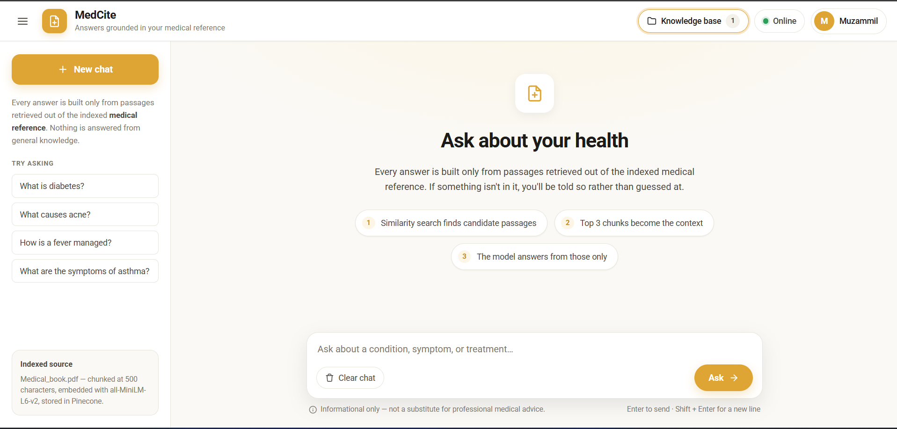

<div align="center">

# MedCite

**A medical question-answering chatbot that answers only from documents you index.**

Retrieval-Augmented Generation over a medical reference PDF — Flask, LangChain
Pinecone, and a Groq-hosted LLaMA model.

<br>



</div>

---

## Table of contents

- [What it does](#what-it-does)
- [Interface](#interface)
- [How it works](#how-it-works)
- [Tech stack](#tech-stack)
- [Project structure](#project-structure)
- [Getting started](#getting-started)
- [Environment variables](#environment-variables)
- [Running locally](#running-locally)
- [Deploying to Vercel](#deploying-to-vercel)
- [Configuration reference](#configuration-reference)
- [Troubleshooting](#troubleshooting)
- [Known limitations](#known-limitations)
- [Roadmap](#roadmap)

---

## What it does

You point MedCite at a medical PDF. It splits the document into chunks, embeds
them, and stores the vectors in Pinecone. When a user asks a question, MedCite
retrieves the passages closest to that question and hands only those passages to
the language model as context.

The model is instructed to answer from that context and to say it does not know
when the context does not cover the question. Answers stay tethered to the
source material instead of the model's general training.

---

## Interface

The UI has no build step — vanilla CSS, inline SVG icons, jQuery from a CDN.
Brand color `#DEA535`, typeface Roboto.

| Region | What it holds |
| --- | --- |
| Header | Wordmark, indexed-document count, connection status |
| Sidebar | New chat, an explanation of the grounding rule, starter questions, and the indexed source with its chunking parameters |
| Empty state | The three retrieval steps a question actually goes through |
| Composer | Auto-growing input — Enter sends, Shift + Enter adds a line — plus the medical disclaimer |

The sidebar collapses from the hamburger and auto-hides below 860 px. Model
output is inserted as a text node, never interpolated into HTML.

---

## How it works

The project has two independent pipelines that share one contract: **the
embedding model, dimension, index, and namespace must match on both sides.**

### Ingestion — `store_index.py` (run once, locally)

```
data/Medical_book.pdf
   │  prepare_book()             pypdf page-by-page extraction
   ▼
Document[]
   │                            retain source, page, model, book hash
   ▼
Document[]  (minimal)
   │  text_split()               RecursiveCharacterTextSplitter
   │                             chunk_size=1000, chunk_overlap=150
   ▼
chunks
   │  PineconeEmbeddings.embed_documents()
   │                             llama-text-embed-v2, passage → 384 dims
   ▼
Pinecone index "medical-chatbot"
   dimension=384 · metric=cosine · serverless aws/us-east-1
```

### Query — `app.py` (runtime)

```
Browser (templates/chat.html)
   │  POST /get   form field: msg
   ▼
Flask route chat()
   ▼
rag_chain = create_retrieval_chain(retriever, question_answer_chain)
   │
   ├─ retriever   PineconeVectorStore.from_existing_index(...)
   │              .as_retriever(search_type="similarity", k=3)
   │              embeddings: PineconeEmbeddings (query mode, 384 dims)
   │              → 3 chunks injected as {context}
   │
   └─ question_answer_chain = create_stuff_documents_chain(chatModel, prompt)
          prompt     ChatPromptTemplate [ system_prompt(+{context}), human {input} ]
          chatModel  ChatGroq(GROQ_MODEL, temperature=0)
   ▼
response["answer"]  →  plain string  →  rendered in the chat UI
```

### Matching document and query embeddings

With `EMBEDDING_PROVIDER=pinecone`, both paths use the **same model and the same
384 dimensions** on Pinecone:

| Path | Where | How embeddings are computed | Why |
| --- | --- | --- | --- |
| Ingestion | Your machine | Pinecone Inference, passage mode | Embed the book once and retain chunk text |
| Query | Flask / Vercel | Pinecone Inference, query mode | Embed only the question; no local ML model |

PDF parsing and optional local MiniLM embeddings remain ingestion-only dependencies.

---

## Tech stack

| Layer | Choice |
| --- | --- |
| Language | Python 3.12 |
| Web framework | Flask 3.1 |
| Orchestration | LangChain 0.3 (`create_retrieval_chain`, `create_stuff_documents_chain`) |
| Vector store | Pinecone (serverless, aws/us-east-1) |
| Embeddings | Pinecone `llama-text-embed-v2` — 384 dims (legacy MiniLM optional) |
| LLM | Groq-hosted LLaMA (configurable via `GROQ_MODEL`) |
| Frontend | Vanilla CSS + jQuery, Roboto, brand `#DEA535` |
| Hosting | Vercel (Python runtime, WSGI) |

---

## Project structure

```
MedCite/
├── app.py                  # Flask app + RAG chain — Vercel entrypoint, no app.run()
├── run_local.py            # Development server (local only)
├── store_index.py          # One-off ingestion script (local only)
├── setup.py                # Package metadata
│
├── requirements.txt        # RUNTIME deps — what Vercel installs
├── requirements-dev.txt    # INGESTION-only deps (torch, pypdf)
│
├── vercel.json             # Function config: 60s timeout, excluded files
├── .vercelignore           # Keeps data/ and venv/ out of the bundle
├── .python-version         # Pins Python 3.12
│
├── .env                    # Secrets — never committed
├── .env.example            # Template
│
├── docs/
│   └── screenshot.png      # README image
│
├── data/
│   └── Medical_book.pdf    # Source corpus (not deployed)
│
├── src/
│   ├── __init__.py
│   ├── helper.py           # PDF load, metadata filter, chunking, local embeddings
│   ├── embeddings_api.py   # HTTP embeddings for the deployed runtime
│   └── prompt.py           # system_prompt
│
├── templates/
│   └── chat.html           # Chat UI
└── static/
    ├── style.css
    └── favicon.svg
```

---

## Getting started

### Prerequisites

- Python 3.12
- A Pinecone account
- A Groq account
- No Hugging Face account is required for Pinecone embeddings
- One or more medical PDFs in `data/`

### Install

```bash
git clone https://github.com/muzammilhussain45/Medical-Chatbot-with-Langchain.git
cd Medical-Chatbot-with-Langchain

python -m venv venv
venv\Scripts\activate            # Windows
source venv/bin/activate         # macOS / Linux

pip install -r requirements.txt -r requirements-dev.txt
```

`requirements-dev.txt` is only needed on the machine that runs ingestion. A
deployment installs `requirements.txt` alone.

---

## Environment variables

Copy the template and fill it in:

```bash
cp .env.example .env
```

| Variable | Required | Used by | Where to get it |
| --- | --- | --- | --- |
| `PINECONE_API_KEY` | Yes | ingestion + runtime | [app.pinecone.io](https://app.pinecone.io) → API Keys |
| `GROQ_API_KEY` | Yes | runtime | [console.groq.com/keys](https://console.groq.com/keys) |
| `EMBEDDING_PROVIDER` | Set to `pinecone` | runtime | Selects Pinecone Inference; legacy default is `huggingface` |
| `PINECONE_NAMESPACE` | Yes for Pinecone embeddings | runtime | Printed by the indexing script |
| `HUGGINGFACEHUB_API_TOKEN` | Only for legacy `huggingface` mode | runtime | Hugging Face token with inference access |
| `GROQ_MODEL` | No | runtime | Defaults to `llama-3.3-70b-versatile` |
| `PINECONE_INDEX_NAME` | No | runtime | Defaults to `medical-chatbot` |
| `RETRIEVER_TOP_K` | No | runtime | Defaults to `3` |
| `LLM_TEMPERATURE` | No | runtime | Defaults to `0` |
| `HF_EMBED_URL` | No | runtime | Override if HuggingFace moves its endpoint |

`.env` is git-ignored. Never commit it.

---

## Running locally

### 1. Build the index — once

```bash
python store_index.py --provider pinecone
```

Parses the PDF, chunks it, embeds the chunks through Pinecone Inference, creates
the index if missing, and uploads vectors plus source text to an isolated namespace.
Copy the printed namespace into `.env`. Reruns skip chunks already indexed.

> **This script is not idempotent.** Running it twice upserts the same chunks
> again under new IDs, producing duplicates. Delete and recreate the index
> before re-ingesting.

### 2. Start the server

```bash
python run_local.py
```

> `app.py` contains no `app.run()` call. Vercel executes it during the build to
> find the WSGI `app` object, so a server started there would hang the deploy.
> `run_local.py` is the development entrypoint; Vercel never uses it.

| Route | Purpose |
| --- | --- |
| `GET /` | Chat interface |
| `GET /health` | Returns index name and active model — check config without asking a question |
| `POST /get` | Form field `msg` → plain-text answer |

Open <http://localhost:8080>.

---

## Deploying to Vercel

Vercel detects Flask automatically from `app.py` exporting a top-level `app`.

1. **Push to GitHub.** Confirm `.env` is not in the commit.
2. **Import the repo** at [vercel.com/new](https://vercel.com/new). Leave build
   and output settings empty.
3. **Add environment variables** before the first deploy — Production, Preview
   and Development:

   ```
   PINECONE_API_KEY
   GROQ_API_KEY
   EMBEDDING_PROVIDER=pinecone
   PINECONE_INDEX_NAME=medical-chatbot
   PINECONE_NAMESPACE=medical-book-9f31dd66ccb58b3a
   GROQ_MODEL
   ```

4. **Deploy**, then hit `/health` first. HTTP 200 confirms configuration exists;
   HTTP 503 reports missing configuration. `/health?deep=1` additionally tests embeddings.

### What makes the deployment fit

A Vercel function is capped at **250 MB unzipped**. Three things keep MedCite
under it:

- `requirements.txt` excludes `torch`, `sentence-transformers` and `pypdf`
- `vercel.json` `excludeFiles` drops `data/`, `venv/` and every PDF
- `.vercelignore` keeps the same paths out of the upload

Re-indexing always happens on your machine, never on Vercel.

---

## Configuration reference

Where to change behavior:

| Change | File |
| --- | --- |
| Persona, answer length, refusal behavior | `src/prompt.py` |
| Chunk size / overlap | `src/helper.py` → `text_split()` |
| Embedding model ⚠ also change index dimension | `src/helper.py`, `src/embeddings_api.py`, `store_index.py` |
| Retrieved chunk count, search type | `RETRIEVER_TOP_K` env var, or `app.py` |
| LLM provider / model / temperature | `GROQ_MODEL`, `LLM_TEMPERATURE`, or `app.py` |
| Index name, cloud, region | `PINECONE_INDEX_NAME` env var; region in `store_index.py` |
| UI, colors, typography | `templates/chat.html`, `static/style.css` |

---

## Troubleshooting

| Symptom | Cause | Fix |
| --- | --- | --- |
| `TypeError: str expected, not NoneType` | No `.env`, or a key is blank | Create `.env` from `.env.example` |
| `groq.NotFoundError: model does not exist or you do not have access` | Model ID retired, or not enabled on your account | List available models with your key, then set `GROQ_MODEL` |
| `HuggingFace embedding request failed` | Endpoint moved, or token invalid | Verify the token; set `HF_EMBED_URL` to the current endpoint |
| Answers are irrelevant | Index empty or built with a different embedding model | Check the vector count in the Pinecone console; rebuild if dimensions differ |
| `LangChainDeprecationWarning` on startup | `HuggingFaceEmbeddings` imported from the old path | Harmless. See the roadmap item below |
| Vercel build fails on function size | A heavy package leaked into `requirements.txt` | Keep torch and friends in `requirements-dev.txt` |

---

## Known limitations

Documented deliberately — these are real, not oversights:

1. **No conversation memory.** Every request is independent; the chain holds no
   history. Follow-up questions are not resolved against earlier turns.
2. **No source citations yet.** The retrieved documents are available on
   `response["context"]` but are not surfaced in the response or the UI.
3. **Answers are returned as a raw string,** not JSON. The frontend inserts them
   as text nodes, so model output is never parsed as markup.
4. **Old namespaces are retained.** Changing the PDF or model creates a separate
   namespace; cleanup is deliberate, never automatic.
5. **`data/Medical_book.pdf` is 16 MB and committed to git,** which makes a
   fresh clone heavy.
6. **This is not clinical advice.** MedCite is a demo over one reference book.
   The UI carries a disclaimer; keep it.

---

## Roadmap

- Surface `response["context"]` sources and page numbers in the UI — the feature
  the name promises
- Multi-turn memory via `create_history_aware_retriever` and a session store
- Streaming responses through `rag_chain.stream(...)` and SSE
- Move `HuggingFaceEmbeddings` to `langchain_huggingface`
- Centralize the remaining hard-coded constants in `src/config.py`
- Multi-PDF upload that calls the ingestion pipeline as a reusable function
- An evaluation set — RAGAS, or a fixed list of golden questions

---

<div align="center">
<sub>MedCite · Informational only · Not a substitute for professional medical advice</sub>
</div>

### Troubleshooting chat requests

With `EMBEDDING_PROVIDER=pinecone`, the deployed request path is Pinecone embeddings
→ Pinecone retrieval → Groq answer generation. Only the question is embedded per
request; the PDF is read during ingestion, not during chat. Retrieved chunk text
stored in Pinecone supplies the evidence for Groq's answer.

- `GET /health` checks configuration only; it does not prove any provider works.
- `GET /health?deep=1` additionally checks the selected embedding provider and its
  384-dimensional output. It does not check Pinecone or Groq.
- Hugging Face HTTP 402 indicates a billing/credit problem. Restore inference
  credits on the token's account, or set `HF_EMBED_URL` to a compatible endpoint
  serving `sentence-transformers/all-MiniLM-L6-v2`. A fresh token for the same
  account does not replenish credits.
- Keep the same embedding model as ingestion. Merely using another model with
  384 dimensions is insufficient; a different model requires rebuilding the
  Pinecone index with that model.
- Set required keys in the deployment's environment settings and redeploy after
  updating them. A local `.env` is not the production environment.
- Chat failures include a reference ID matching sanitized server logs. Provider
  response bodies and credentials are not returned to the browser.

The medical-only policy lives in `src/prompt.py`. Unsupported medical questions
receive a fallback about the **retrieved passages**, rather than a claim that
nothing exists in the entire book. Off-topic questions receive a medical-topic
redirect. Greetings are handled without external APIs; other questions still
require working retrieval. Prompt rules reduce unwanted answers but are not a
hard security boundary.

Run offline regression checks with:

```bash
python -m unittest discover -s tests -v
```

### Pinecone embeddings on Vercel (recommended)

Pinecone can generate embeddings as well as store and search them. This app uses
Pinecone Inference's `llama-text-embed-v2` at 384 dimensions for both documents and
questions. It uses `passage` mode for book chunks and `query` mode for questions.
There is no Hugging Face inference call or local torch dependency in this mode.

As checked on October 14, 2026, Pinecone's Starter plan includes 5 million tokens
per month for this model. Database, Groq, and Vercel have separate usage limits;
this is a quota-limited setup, not unlimited free hosting. Keep the account on
Starter. The app does not upgrade plans, buy credits, or fall back to paid models.
See [Pinecone pricing](https://www.pinecone.io/pricing/) for current allowances.

Re-embed the book once with:

```bash
python store_index.py --provider pinecone --pdf data/Medical_book.pdf
```

The job skips already stored chunk IDs on reruns to avoid spending embedding tokens
twice, paces requests, and stops on provider errors. If a rate limit interrupts it,
wait and rerun the same command. For an exhausted monthly quota, wait for its reset.

Set these in Vercel's **Production** environment alongside `PINECONE_API_KEY` and
`GROQ_API_KEY`, then deploy the updated code:

```dotenv
EMBEDDING_PROVIDER=pinecone
PINECONE_INDEX_NAME=medical-chatbot
PINECONE_NAMESPACE=medical-book-9f31dd66ccb58b3a
GROQ_MODEL=openai/gpt-oss-20b
```

That namespace belongs to the supplied PDF embedded by Pinecone. Use the printed
namespace if your PDF or chunking changes. Do not point Pinecone embeddings at the
older MiniLM namespace, even though both models produce 384 numbers. Retrieval
also filters by model metadata to prevent mixing incompatible vectors.

After deployment, `/health?deep=1` should show `embedding_provider: pinecone`, the
new namespace, and 384 dimensions. Then ask a medical question to test retrieval
and Groq as well. Never run ingestion inside the Vercel request or build process.

### Alternative: index with local MiniLM embeddings

Ingestion runs on your computer, using local CPU embeddings. It does not consume
Hugging Face inference credits. Install both requirements files, then run:

```bash
python store_index.py --pdf data/Medical_book.pdf --dry-run
python store_index.py --pdf data/Medical_book.pdf
```

The script extracts text page by page, creates 1,000-character chunks with
150-character overlap, and embeds them with `sentence-transformers/all-MiniLM-L6-v2`
(384 dimensions). It stores text, source filename, and one-based PDF page numbers
in Pinecone. The model downloads once to `.cache/models/`.

Each PDF/chunking version gets its own namespace. Deterministic vector IDs make
rerunning the same job safe without adding duplicates. Old namespaces are retained;
the script does not delete existing data. Wait for the final verified vector count
before using the new namespace. The report is saved to `.cache/index-report.json`.

For the supplied `Medical_book.pdf`, select this namespace in the app environment:

```dotenv
PINECONE_INDEX_NAME=medical-chatbot
PINECONE_NAMESPACE=medical-book-bf692cedeb367000
```

Use the namespace printed by the script if the PDF or chunking settings change.

For local development without hosted embedding fees, also set:

```dotenv
EMBEDDING_PROVIDER=local
```

Then restart the app with `python run_local.py`. Local mode still uses Pinecone
for retrieval and Groq for answers, so both of those keys remain required.

For the legacy MiniLM path on Vercel, set `EMBEDDING_PROVIDER=huggingface` and the same `PINECONE_NAMESPACE`,
along with the three provider keys, then redeploy. The current Vercel build excludes
the large local torch dependencies. Hosted Hugging Face embeddings need available
inference credits or a compatible `HF_EMBED_URL`; indexing the PDF does not resolve
HTTP 402 when the app embeds a new question. Running local embeddings in production
requires a host with enough space and memory for the model and torch dependencies.
